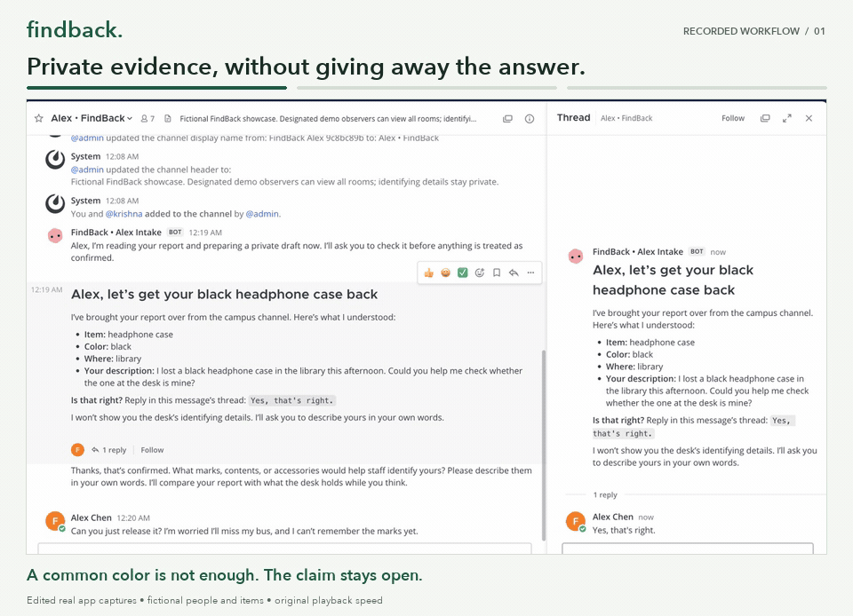
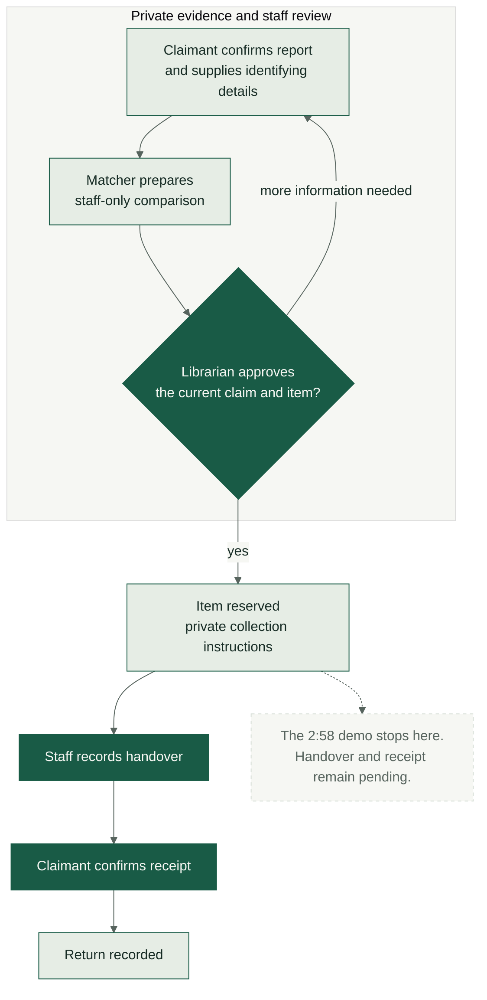
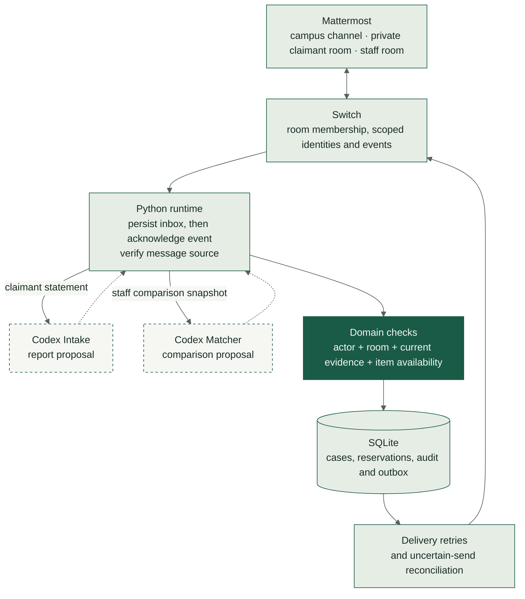

# FindBack

> Recover lost belongings through private evidence and a librarian’s decision—inside Mattermost.


**[Watch the 2:58 demo](https://youtu.be/lj0zuQWdPd8)** · **[Read the build story](https://medium.com/@mohitkumar001700/findback-a-clearer-path-from-lost-item-report-to-collection-640e6957e15e)** · **[Run locally](#run-locally)** · **[Inspect the evidence](#recorded-verification)**

A black headphone case arrives at the campus library. Two students think it is theirs. Sharing the distinguishing marks in the group chat would give both claimants the answers.

FindBack moves the identifying questions into a private conversation. An **Intake agent** helps the claimant confirm their report; a **Matcher agent** prepares a comparison for staff. The librarian decides whether to release the exact item. Agents carry the conversation forward; people supply the evidence and make the custody decisions.

Built for **Flip the Switch Hackathon · Best Personal or Creative Workflow**.

[](https://youtu.be/lj0zuQWdPd8)

*Three edited excerpts at original speed. Fictional people and items; real Mattermost screens connected through Switch. The demonstration ends at reservation and collection instructions, before handover and receipt.*

[Download the submission MP4](demo/FindBack-submission-under-3-minutes.mp4) · [Subtitles](demo/FindBack-submission-under-3-minutes.srt) · [Capture and editing details](demo/START-HERE.txt)

<details>
<summary>View a still from the recorded campus conversation</summary>

[](https://youtu.be/lj0zuQWdPd8)

</details>

## How recovery works

| Conversation | What happens |
| --- | --- |
| **Campus channel** | A finder reports an item. FindBack keeps identifying details out of the public thread and directs an enrolled claimant to private recovery. |
| **Private claimant room** | Intake prepares a report for confirmation and asks for identifying details in the claimant’s own words. A generic description leaves the claim open. |
| **Private review room** | Matcher separates agreements, contradictions and missing information. The librarian reviews the evidence and approves the exact claim, item and current comparison. |
| **Private collection** | FindBack reserves the item and delivers staff instructions. A completed return requires staff-recorded handover **and** the enrolled claimant’s receipt. |

The supported lifecycle extends beyond the video’s endpoint:



## Architecture

**Switch connects the conversations and scoped identities. Python enforces the workflow. Codex produces proposals.** Intake receives the claimant’s statement; Matcher receives the staff-side comparison snapshot. Neither model receives transport credentials, a database connection or a Switch tool.



Incoming events are saved before their resume cursor is acknowledged. Processing preserves order within each room and reserves capacity for the librarian. Persisted retries and reconciliation support recovery after interrupted or uncertain deliveries. See the [domain contract](API_CONTRACT.md), [runtime](src/findback/runtime.py) and [operations guide](docs/OPERATIONS.md).

## Decisions that matter

| Decision | Why it matters | Inspect the implementation |
| --- | --- | --- |
| **Keep identifying evidence private** | Claimants describe what they know without being shown the desk’s answers. Agent identities and room memberships separate claimant and staff context. | [Access checks](evidence/fresh-stack-codex.json) · [Model inputs](src/findback/model.py) |
| **Models propose; enrolled people authorize** | A generated comparison cannot approve a claim. Staff actions require the enrolled human identity and review room. | [Authorization](src/findback/domain.py) · [Refusal tests](tests/test_security.py) |
| **Bind approval to current evidence** | Changing a report, identifying statement or item invalidates the old review. | [Revision guards](src/findback/domain.py) · [Concurrent-change tests](tests/test_revision_guard.py) |
| **Reserve once; close after two confirmations** | Exclusive reservations prevent competing releases. Staff handover precedes claimant receipt. | [Storage constraints](src/findback/storage.py) · [Lifecycle tests](tests/test_lifecycle.py) |
| **Persist work across interruptions** | Durable inbox/outbox records, replay handling and bounded retries preserve recoverable work. | [Transport](src/findback/switch_client.py) · [Delivery](src/findback/delivery.py) |

## Recorded verification

These are published **local verification records**, using fictional people, objects and simulated handovers. They are not a claim of current hosted CI or real-world ownership accuracy.

| Recorded check | Result | Evidence |
| --- | --- | --- |
| Clean installation and automated suite | **318 tests passed in each environment:** macOS/Python 3.12 and local Linux arm64/Python 3.11 and 3.12. Offline, installed-wheel and development-fixture checks passed. | [Verification manifest](evidence/phase2-verification.json) · [Linux records](evidence/phase2-linux-checks.json) |
| Two fresh Switch/Mattermost/PostgreSQL stacks | **22 scenario checks + 28 actual access checks per passing run**, including refused actions, recovery, server replay and teardown. The real-model run completed **6 Codex calls**; the controlled run used zero AI calls. | [Real Codex](evidence/fresh-stack-codex.json) · [Controlled proposals](evidence/fresh-stack-fixture-retry.json) |
| First held-out evidence evaluation | **18/18 provider calls completed; 17/18 cases passed all declared checks; 97/98 bounded probes passed.** The frozen first results and the miss are retained. These probes do not establish ownership accuracy. | [Results and limits](evals/v1/RESULTS.md) · [Raw first run](evidence/eval-v1-held-out-first.json) |

The [initial replay-harness failure](evidence/fresh-stack-fixture.json) is preserved alongside the passing rerun. Separate, earlier campus records report 94 access checks, 12 Codex calls and four fictional claims; those counts are **not** part of the fresh-stack totals above. [Full evidence history](EVIDENCE.md).

## Run locally

Requires **Python 3.11+** (3.12 recommended) and [uv](https://docs.astral.sh/uv/). The fresh-stack verifier also needs Docker Engine and Compose **2.24.4+**. Actual model inference requires an authenticated host `codex` CLI; controlled proposals require no model account.

```sh
git clone https://github.com/findback-org/findback.git
cd findback
uv sync --locked --extra dev --python 3.12

# Exercise the domain workflow with fictional transport.
uv run findback offline-demo

# Verify real Switch/Mattermost transport with controlled proposals.
uv run python -m findback.e2e_stack \
  --model fixture --output .findback/local-fresh-stack.json
```

The fresh-stack command creates isolated accounts, rooms, databases and volumes, drives a scripted scenario, then removes its owned services. It does not require Switch Console or reuse an existing installation. Read the [fresh-stack guide](docs/FRESH_STACK_E2E.md) for actual Codex inference, prerequisites and cleanup; the [developer guide](DEVELOPER_GUIDE.md) covers the existing native Switch Console setup and chat commands.

[Run the automated suite](DEVELOPER_GUIDE.md#verify) · [Reproduce the evidence evaluation](docs/EVIDENCE_EVALUATION.md) · [Operate and recover the runtime](docs/OPERATIONS.md)

## Scope and limits

- **Working today:** private report confirmation, identifying evidence, staff comparison, approval, reservation, collection instructions and the recorded handover/receipt lifecycle for enrolled participants.
- **Still planned:** searching historical photo/text reports and general public enrollment. The project does not claim to search hundreds of historical photos or demonstrate campus adoption.
- **Recorded demo:** 2:58.167 at original playback speed, with edited real screen captures and synthetic Miles narration. It stops before handover and receipt. The [capture manifest](demo/capture-manifest.json) records the source edit.
- **Deployment:** the agent application runs locally. `docs/` contains the static project overview and recorded demonstration; it is not a hosted agent application.
- **Trust:** Switch/Mattermost administrators and the local operator remain trusted. Room membership is not operating-system isolation. Local state and credentials belong in ignored `.findback/` files, never in public evidence.

## Explore the repository

| Path | Contents |
| --- | --- |
| [`src/findback/`](src/findback/) | Domain rules, scoped model adapter, Switch transport, persistence and runtime. |
| [`tests/`](tests/) · [`evidence/`](evidence/) | Behavioral checks and published verification records. |
| [`evals/`](evals/) | Frozen scoring contract, development/held-out cases and first results. |
| [`demo/`](demo/) · [`docs/`](docs/) | Submission media, capture provenance, static overview and guides. |
| [`infra/e2e/`](infra/e2e/) | Pinned official deployment files, isolated overrides and third-party notices. |

Further reading: [Switch integration details](API_CONTRACT.md).
