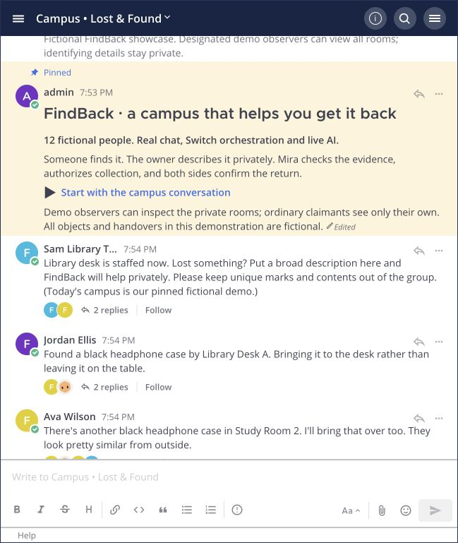
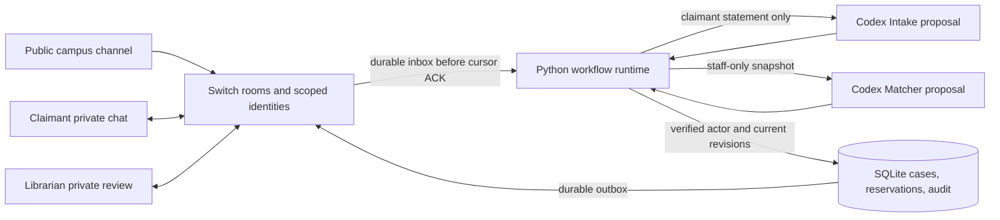

# FindBack

[](https://github.com/Krishna3451/findback/actions/workflows/ci.yml)

### Lost something? Start a conversation.

A black headphone case arrives at the campus library. Two students think it might be theirs. The outside looks the same. The detail that could settle it is inside—and sharing that detail with the whole group would give away the answer.

FindBack helps carry that conversation through: private identifying questions, a clear comparison for the librarian, and a return recorded only after handover and receipt. Built with **Switch, Codex, and Mattermost** for the **Flip the Switch Hackathon · Best Personal or Creative Workflow**.

**[Watch the demo · 3:09](https://youtu.be/CwU4WdZB-Sk)** · **[Visit the landing page](https://krishna3451.github.io/findback/)** · **[Implementation evidence](EVIDENCE.md)** · **[Developer guide](DEVELOPER_GUIDE.md)**



## The story

The community channel is where people hear about a found item. The identifying questions belong somewhere private.

An **Intake** agent helps a claimant describe their loss without revealing the answers staff are checking. A **Matcher** agent prepares the librarian’s comparison: what agrees, what contradicts the claim, and what still needs an answer. The librarian decides whether to release the specific item. Collection details go to the approved claimant privately.

An appointment is not a return. The case closes only when staff record the handover and that claimant confirms receipt. If the evidence is too broad, the case stays open.

## What runs today

- Private claimant conversations and a separate librarian review room, connected to an actual campus Mattermost channel through Switch.
- Live Codex calls for structured report intake and staff-only evidence comparison.
- Replies bound to the relevant report, review, and handover messages.
- Librarian-only release of the exact reviewed claim and item; one active reservation per item.
- Persistent cases, evidence revisions, approvals, audit records, and return receipts in SQLite.
- Scoped agent identities, verified message senders, restart handling, and replay checks.

**Next:** finding older photo and text reports buried in a busy campus group. Historical photo search and general public enrollment are still planned. The current build demonstrates verification and return; it does not claim to search hundreds of historical photos.

## Watch the demo

**[FindBack on YouTube · 3 minutes 9 seconds](https://youtu.be/CwU4WdZB-Sk)** · [Download MP4](demo/FindBack-submission-demo.mp4)

The narrated walkthrough follows Alex’s claim through private evidence, librarian review, and approved collection. Its endpoint is **approved and reserved**, before handover or receipt. The [earlier campus demonstration](evidence/live-campus/verification.json) separately records three completed simulated returns and one unresolved claim.

The people and objects are fictional. Switch transport, Mattermost messages, and model calls are real. The finished video uses edited captures of the actual browser, including reading holds and smooth transitions, with synthetic narration by Miles. It is not continuous footage or evidence that a physical object changed hands. [Subtitles](demo/FindBack-submission-demo.srt) and [capture details](demo/START-HERE.txt) are included.

## How Switch is used

Switch is the messaging layer for the workflow. It connects a Python runtime to the local Mattermost collaboration and gives the agent roles their own identities and room memberships.

| Participant | Conversation | Responsibility |
| --- | --- | --- |
| Campus community | Lost-and-found channel | Broad found notices and community discussion. |
| Claimant + Intake | Private case conversation | Loss description, non-leading questions, identifying evidence, and receipt. |
| Librarian + Matcher | Private review room | Evidence comparison, release decision, and handover record. |
| FindBack service | Explicitly enrolled workflow rooms | Validate actions, save case state, and deliver the appropriate messages. |

Intake receives its claimant’s report. Matcher receives the staff-side comparison snapshot. Codex proposes and explains; application code checks identity and case revisions before applying any action. Neither model can approve a claim or operate Switch directly.



Switch supplies the rooms, agent identity, memberships, message context and event transport. Python owns the domain rules. Removing Switch removes the actual human–agent conversations and their identity-bound delivery; the isolated domain demo below deliberately uses fictional transport instead.

## Technical decisions you can verify

| Property | Implementation and failure check |
| --- | --- |
| A model cannot release an item | [Typed, tool-disabled proposal adapter](src/findback/model.py); [tool attempts and invalid output are refused](tests/test_model.py). Approval still requires an enrolled human librarian. |
| An old comparison cannot approve new evidence | [Revision-bound domain transactions](src/findback/domain.py); [evidence changing during inference invalidates the result](tests/test_revision_guard.py). |
| Two approvals cannot reserve the same object | [SQLite partial unique indexes and immediate transactions](src/findback/storage.py); [competing approvals, rollback, replay and restart tests](tests/test_domain.py). |
| Display names and quoted text are not authority | [Mattermost post/account/body verification](src/findback/runtime.py); [forged, relayed, webhook and agent impersonation checks](tests/test_runtime.py). |
| A backlog cannot silently discard an older human action | [Bounded, timestamp-aware source-history verification](src/findback/provenance.py); [older approvals, public reports, boundary ties and unavailable-proof checks](tests/test_provenance.py). Missing proof remains failed for operator attention. |
| A slow claimant does not freeze every conversation | At most four rooms process concurrently, with one slot reserved for the librarian and input order preserved within each room; [blocked-model, backlog, saturation and shutdown/replay checks](tests/test_scheduling.py). |
| Failed notifications cannot fill every delivery batch | [Persisted due times, bounded retries and blocked states](src/findback/delivery.py) apply to both queues and the real showcase; [restart, uncertain-POST reconciliation, migration and privacy checks](tests/test_delivery.py). |
| Reconnect does not silently skip received events | [Persistent Switch generation and cursor handling](src/findback/switch_client.py); [unacknowledged frames, gaps, eviction and unknown HTTP outcomes](tests/test_switch_client.py). |

These automated checks use fictional data and controlled providers. [Live integration records](EVIDENCE.md) separately establish that the Switch identities, room access boundaries and Codex calls worked on the local stack. They do not establish real-world ownership accuracy.

Operators can inspect payload-free queue health with `findback health` and explicitly recover failed notifications with `findback retry-delivery`. [Operations and recovery](docs/OPERATIONS.md) explain the retry budget, unknown outcomes, queue-ordering limits and safe restart. Queue health is not a network or process-liveness check.

## Run locally

### Requirements

- Python 3.12 and [uv](https://docs.astral.sh/uv/).
- The native macOS Switch Console installation, with its local server and bundled Mattermost running.
- An authenticated `codex` CLI available on `PATH` for live model calls.

The bootstrap currently targets this native macOS setup. It is not a generic remote-server installer. The landing page itself is static and needs none of these services.

```sh
git clone https://github.com/Krishna3451/findback.git
cd findback
uv sync --locked --extra dev --python 3.12
```

Try the domain workflow without connecting to chat:

```sh
uv run findback offline-demo
```

Connect the developer fixture to the running local Switch server:

```sh
uv run findback doctor
uv run findback bootstrap
uv run findback run
```

Bootstrap provisions the demo’s private rooms, scoped identities, and fictional accounts. It reuses existing records without resetting progressed cases. Keep the runtime listening, open Mattermost, and use the enrolled accounts. The [developer guide](DEVELOPER_GUIDE.md) documents chat commands, account setup, and private session reuse.

To create a separate scripted campus showcase with its own history:

```sh
uv run python -m findback.showcase --viewer-username YOUR_MATTERMOST_USERNAME --pace 0.7
```

Use your existing local Mattermost username. The command prints the actual room URL, runs fictional participant messages through real accounts, and leaves the agents listening. 

## Verification

```sh
uv run pytest -q
```

The [CI workflow](.github/workflows/ci.yml) installs the locked dependencies on Linux (Python 3.11 and 3.12) and macOS (Python 3.12), runs the behavioral suite and offline workflow, builds a wheel, then installs and exercises that wheel outside the source checkout. It needs no Switch server, model credentials or production secrets. The native macOS bootstrap and live integration checks are separate.

Preserved campus evidence includes **94 live access checks**, **12 live Codex calls**, and four fictional claims. Those are local demonstration results, not campus adoption or accuracy measurements. The [evidence log](EVIDENCE.md) records dated local test counts; the CI result establishes the state of each published commit.

Tests cover authorization, stale reviews, double reservation, handover-before-receipt, duplicate events, restart behavior, and private output routing. [EVIDENCE.md](EVIDENCE.md) distinguishes automated tests, live integration checks, and scripted inputs.

## Repository map

| Path | Contents |
| --- | --- |
| [`src/findback/`](src/findback/) | Domain workflow, storage, matching, Codex adapter, Switch transport, bootstrap, and demo runners. |
| [`tests/`](tests/) | Automated behavioral and integration-adapter tests. |
| [`docs/`](docs/) | Static landing page and embedded demo, ready for GitHub Pages. |
| [`demo/`](demo/) | Submission video, subtitles, narration scripts, and edit manifests. |
| [`evidence/`](evidence/) | Redacted run records, access checks, captures, and verification. |
| [`scripts/`](scripts/) | Reproducible capture, narration, and video assembly utilities. |

## GitHub Pages

The landing page is served from this same repository: **Settings → Pages → Deploy from a branch → `main` → `/docs`**. There is no build step. GitHub Pages hosts the explanation and recorded demo; the live agent workflow runs locally with Switch.

## Private state

Local credentials and account tokens live under `.findback/` and are excluded from Git, alongside `.env`, databases, virtual environments, and caches. Public evidence uses fictional data. Switch/Mattermost administrators and the local operator remain trusted; room membership is not operating-system isolation.

## Read more

- [Developer guide and command reference](DEVELOPER_GUIDE.md)
- [API and authorization contract](API_CONTRACT.md)
- [Queue health, delivery recovery and restart](docs/OPERATIONS.md)
- [Flip the Switch Hackathon](https://www.wemakedevs.org/hackathons/switch)
- [Switch getting started](https://docs.switchagents.ai/switch-rooms/getting-started)
